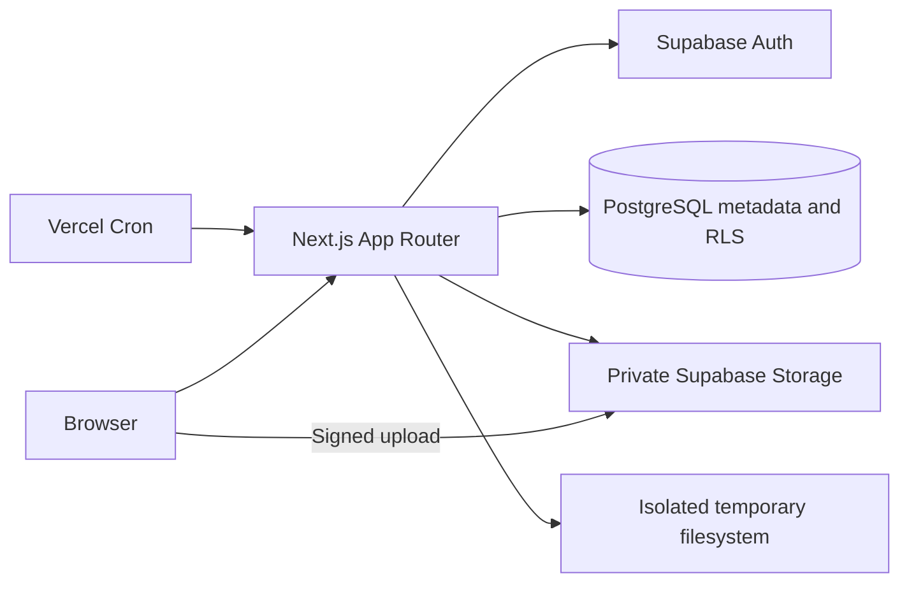
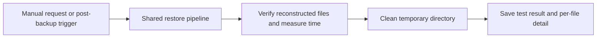
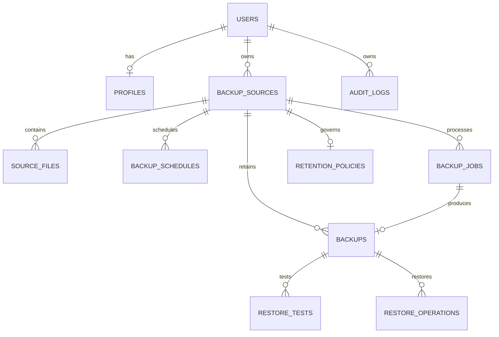

# Architecture

The browser talks to Next.js for authenticated metadata and operations. Upload content goes directly to a per-file signed Supabase Storage URL. The server validates metadata, checks ownership, performs bounded processing in Node.js and coordinates PostgreSQL and the private buckets. Expiring per-user leases serialize mutating actions. Vercel Cron invokes the same backup operation for due schedules.

The ZIP contains a versioned manifest of relative paths, sizes and SHA-256 values. The stored checksum is computed over the exact object, which may be an authenticated encrypted envelope. The verification pipeline also compares the internal manifest against the database copy. Restore tests re-read actual reconstructed files from a private temporary directory and discard the directory in a finally block.
